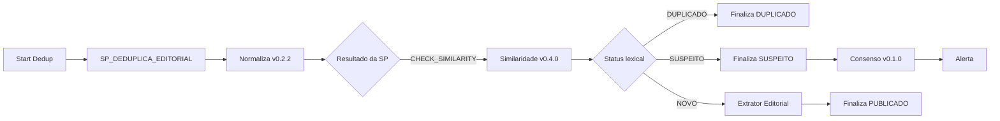
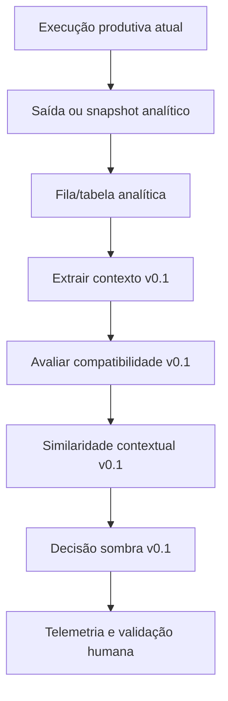

# Evolução por evento, faceta e estado factual

Data da proposta: 20/10/2026.

## Decisão arquitetural

A nova análise será desenvolvida em modo sombra. O fluxo produtivo atual continua responsável por `NOVO`, `SUSPEITO` e `DUPLICADO`; a linha sombra apenas observa os mesmos candidatos, calcula uma decisão sugerida e grava telemetria separada.

Essa separação evita que uma falha de extração, latência adicional ou regra experimental altere publicação, status, alertas ou inserções funcionais.

## Baseline observado

O export M360 mais recente mantém 15 nodes e esta sequência funcional:

O Consenso v0.1.0 é analítico, possui `aplicado_automaticamente: false` e ocorre depois da finalização como `SUSPEITO`. Portanto, não é hoje uma etapa de decisão anterior ao roteamento.

## Linha sombra

O acionamento deve ocorrer depois que os dados necessários estiverem disponíveis, por fila ou tabela. A execução sombra não deve estar no caminho síncrono que devolve a resposta ao fluxo pai.

## Contrato de contexto v0.1

Cada candidato e comparável deve conter:

- evento principal e tipo de evento;
- entidades com papéis, incluindo participantes, pessoa principal e objeto;
- competição, divisão, rodada e data do evento;
- faceta editorial, como transmissão, escalação provável, escalação oficial, desfalques, resultado, repercussão ou tabela;
- estado factual, como previsto, possível, anunciado, confirmado, ocorrido ou atualizado;
- modalidade da afirmação;
- data de publicação/coleta separada da data do evento;
- confiança de extração e campos desconhecidos;
- versão do extrator e das taxonomias.

Entidade citada como contexto secundário não deve ser promovida automaticamente a participante do evento principal. Campos ausentes permanecem desconhecidos e reduzem a autonomia da decisão.

## Avaliação por par

A ordem da análise é:

1. extrair contexto do candidato e do comparável;
2. detectar contradições críticas;
3. classificar relação de evento, faceta e estado;
4. calcular similaridade somente para o contexto compatível;
5. produzir decisão e justificativa estruturada;
6. continuar examinando os demais comparáveis antes da decisão do candidato.

Bloqueadores típicos incluem adversário, pessoa principal, competição/divisão, rodada/data e objeto incompatíveis. Diferenças entre pré-jogo, resultado, provável, confirmado, texto e vídeo podem representar conteúdo relacionado ou atualização, conforme a política editorial; não são automaticamente duplicidade.

## Persistência analítica

A primeira versão deve usar objetos separados para:

- execução e versões;
- snapshot do candidato e dos comparáveis;
- contexto extraído;
- compatibilidade e bloqueadores de cada par;
- scores antigo e novo;
- decisão atual e decisão sugerida;
- validação humana e motivo.

A chave de idempotência deve incluir execução, candidato, comparável e versão analítica. A linha sombra não chama `SP_DEDUPLICA_EDITORIAL_FINALIZA`, não grava `PUBLICADO` e não insere na tabela funcional de títulos.

## Promoção gradual

1. **Sombra:** comparação sem efeito funcional.
2. **Assistida:** sugestão e justificativa visíveis ao editor.
3. **Veto conservador:** contradições críticas encaminham possíveis duplicados para revisão.
4. **Canário restrito:** automação somente em classes validadas e sob feature flag.
5. **Ampliação por classe:** cada contexto é promovido com métricas e rollback próprios.

O veto conservador é a primeira interferência recomendada porque privilegia a prevenção de falso duplicado. A promoção de `DUPLICADO` exige base humana com casos positivos e negativos difíceis; os 51 alertas suspeitos atuais servem como regressão, mas não como verdade editorial completa.

## Métricas e gates

- cobertura e confiança da extração de contexto;
- taxa de contexto desconhecido por campo;
- divergência entre baseline, sombra e decisão humana;
- falso duplicado por classe editorial;
- latência e falhas do fluxo sombra;
- volume encaminhado para revisão;
- distribuição por versão de regra;
- ausência comprovada de efeitos funcionais durante a sombra.

Nenhum threshold global deve ser promovido a partir dos alertas atuais. A evidência mostrou possível mesma notícia a 74,79% e casos ambíguos a 80,5%; evento, faceta e estado precisam qualificar o score.

## Dependências abertas

- definições vigentes de `SP_DEDUPLICA_EDITORIAL` e `SP_DEDUPLICA_EDITORIAL_FINALIZA`;
- contrato real do `Chamar Extrator Editorial`;
- amostras rotuladas dos três ramos produtivos;
- decisão editorial sobre `RELACIONADO` e `ATUALIZAÇÃO`;
- conteúdo e referências temporais dos casos prioritários.

O acompanhamento dessas dependências está no [backlog consolidado](../planejamento/BACKLOG.md).
