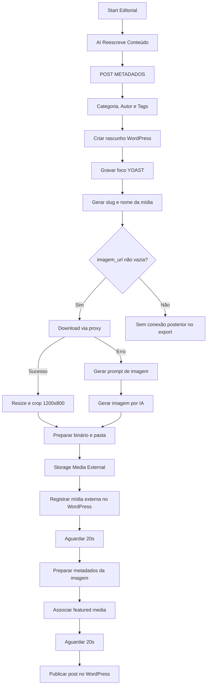

# Contrato observado — Extrator Editorial M360 v0.3

Data da incorporação: 21/10/2026.

## Finalidade

O `SUB | WEB Extrator Detalhes M360 v0.3 [ Core Editorial ]` recebe título e link de um candidato considerado `NOVO`. Seu objetivo funcional é extrair e reescrever o conteúdo, formatar os dados editoriais, classificar categoria/autor/tags, preparar mídia ilustrativa e publicar o post no M360.

O workflow possui efeitos de escrita e publicação. Ele faz parte do caminho produtivo posterior à deduplicação e não deve ser reutilizado pelo modo sombra da Sprint v0.2.0.

## Artefatos

- [Export sanitizado e inativo](../../workflows/m360-extrator-detalhes-v0.3.json)
- [Code node GERA SLUG](../../codes/m360-extrator/gera-slug.js)

O export original estava ativo, possuía `pinData` e cinco referências de credenciais. A cópia pública usa `active: false`, não contém `pinData` e não contém objetos `credentials`. Nenhum node foi executado durante a incorporação.

## Contrato de entrada

| Campo | Tipo observado | Origem no Core de deduplicação |
| --- | --- | --- |
| `Título` | string | `candidato.titulo` |
| `Link` | string | `candidato.link` |

Os campos não estão marcados como obrigatórios no trigger do Extrator, embora o fluxo consumidor envie ambos.

## Sequência observada

## Subfluxos dependentes

| Node | Subfluxo | Entradas observadas | Saídas consumidas |
| --- | --- | --- | --- |
| `Chamar Reescrever v0.2` | `SUB1 - AI Reescreve Conteudo v0.2 [ Core Editorial ]` | `link` | `titulo`, `conteudo`, `imagem_url`, `imagem_leg` |
| `M360 Categoria e Tags` | `SUB - M360 | Categoria | Autor | Tags` | `titulo`, trecho de `contexto` | `categories[0]`, `tags`, `autor[0]` |
| `Chamada Prompt` | `SUB3 - AI PROMPT DE IMG` | `txt_Tema`, `dsc_Contexto` | `text` |
| `Chamada IA IMG` | `SUB4 - AI GERAR IMAGEM API [Cross]` | `Prompt_text`, `txt_Tema`, `Txt_Contexto` | imagem/binário encaminhado ao storage |
| `CALL | Maneger Storage Provider` | `SUB | Storage Media External` | item/binário corrente | `sha256`, `asset_id`, `public_id`, `secure_url`, dimensões, MIME, nome e provider |

As saídas acima foram inferidas exclusivamente dos campos consumidos pelos nodes seguintes. Os exports dos cinco subfluxos ainda não foram fornecidos, portanto validação, fallback e efeitos internos permanecem desconhecidos.

## Tratamentos de dados

### Reescrita e formatação

O resultado do subfluxo de reescrita é normalizado em:

- `TITULO`;
- `CONTEUDO`;
- `IMG_URL`;
- `IMG_LEG`.

O contexto enviado à classificação é extraído do conteúdo entre `<h3><i>` e `</i></h3>`. Esse contrato depende de a marcação existir no texto reescrito.

### Slug e arquivo

O único Code node local remove acentos, troca grupos não alfanuméricos por hífen, remove hífens duplicados ou nas extremidades e converte para minúsculas. A saída é:

- `slug`;
- `fileName`, no formato `<slug>.webp`.

### Classificação editorial

Categoria, autor e tags são obtidos por subfluxo. O rascunho WordPress usa somente `categories[0]` e `autor[0]`, além da lista de tags.

### Mídia

Quando `imagem_url` não está vazia, o fluxo tenta baixar a imagem pelo proxy. O download possui duas tentativas, intervalo de cinco segundos e envia falhas para uma saída específica. Essa saída aciona geração de prompt e imagem por IA.

No caminho de sucesso, a imagem é redimensionada para 1200 pixels de largura e cortada para 1200 × 800. Ambos os caminhos convergem para storage, registro da mídia externa e associação como featured media.

## Efeitos externos

| Efeito | Node |
| --- | --- |
| Criar post WordPress com status `draft` | `Publicar WP Draft` |
| Inserir `_yoast_wpseo_focuskw` em `wp_postmeta` | `Add YOAST Focus KW` |
| Baixar imagem através de proxy | `Download IMG - Proxy` |
| Armazenar mídia por provedor externo | `CALL | Maneger Storage Provider` |
| Registrar mídia externa no WordPress | `Registrar Provider Mídia Virtual WP` |
| Associar mídia, alt, título, descrição e legenda | `Associar Featured Media Virtual` |
| Alterar o post para status `publish` | `HTTP WP Publish` |

Esses efeitos impedem a execução segura do workflow em uma análise sombra. O fluxo sombra deve usar snapshots de entrada e encerrar antes de qualquer chamada ao Extrator.

## Contrato de saída

Não existe um node de retorno que normalize a saída. O último node é `HTTP WP Publish`; portanto, a saída aparente é a resposta desse request. Seu formato, cardinalidade e códigos funcionais precisam ser confirmados com um snapshot sanitizado.

No fluxo de deduplicação, a conclusão do Extrator é seguida por `SP_DEDUPLICA_EDITORIAL_FINALIZA` com status `PUBLICADO`. O export não mostra uma validação explícita do corpo da resposta antes dessa finalização.

## Observações para regressão

1. O ramo falso do teste de `imagem_url` não possui conexão posterior no export.
2. O teste verifica valor não vazio; não há validação explícita de URL nem tratamento específico para a string `null`.
3. O fallback por IA ocorre no erro do download, não no ramo sem imagem.
4. O node `Wait 21s` está configurado com quantidade 20.
5. O request final de publicação possui duas tentativas com intervalo de cinco segundos.
6. Não há compensação explícita visível para rascunho, metadado SEO ou mídia quando uma etapa posterior falha.
7. Não há chave de idempotência explícita visível nos requests de criação e publicação.

Essas observações descrevem o export recebido. Qualquer correção será tratada em iniciativa própria e validada fora do fluxo produtivo.

## Relação com o modo sombra v0.2.0

O Extrator pertence ao lado de execução editorial posterior à decisão `NOVO`. O modo sombra deverá:

- consumir uma cópia do candidato e dos comparáveis;
- calcular contexto, compatibilidade e decisão sugerida;
- persistir apenas telemetria analítica;
- retornar `aplicado_automaticamente: false`;
- nunca chamar o Extrator, WordPress, storage ou a finalização produtiva.

O acompanhamento das dependências permanece no [registro da S20-01](../sprints/S20-01-BASELINE.md).
