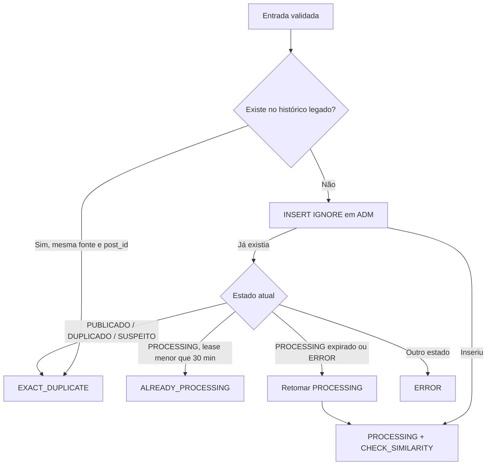

# Contrato observado — SPs editoriais M360 v0.2.2

Data da incorporação: 21/10/2026.

Origem informada: ambiente Mengão 360.

## Artefatos

- [`SP_DEDUPLICA_EDITORIAL.sql`](../../sql/editorial/SP_DEDUPLICA_EDITORIAL.sql)
- [`SP_DEDUPLICA_EDITORIAL_FINALIZA.sql`](../../sql/editorial/SP_DEDUPLICA_EDITORIAL_FINALIZA.sql)
- [`ADM_deduplica_editorial.sql`](../../sql/editorial/tables/ADM_deduplica_editorial.sql)
- [`titulos_deduplica.sql`](../../sql/editorial/tables/titulos_deduplica.sql)

Os corpos das procedures foram preservados e somente a cláusula `DEFINER` foi removida. Nos DDLs, somente os próximos valores de `AUTO_INCREMENT` foram removidos. A análise é estática; nenhuma query foi executada.

## SP_DEDUPLICA_EDITORIAL

### Assinatura

| Parâmetro | Tipo | Uso observado |
| --- | --- | --- |
| `p_portal` | `VARCHAR(50)` | Deve resultar em `M360` após normalização |
| `p_titulo` | `VARCHAR(500)` | Título obrigatório |
| `p_categoria` | `VARCHAR(100)` | Categoria opcional |
| `p_url_origem` | `VARCHAR(500)` | URL obrigatória e fonte do host |
| `p_post_id` | `VARCHAR(555)` | Caminho/slug obrigatório |
| `p_janela_dias` | `INT` | Default 7; mínimo efetivo 1 e máximo 30 |
| `p_execucao_id` | `VARCHAR(100)` | Correlação com a execução n8n |

A assinatura corresponde aos sete argumentos do node `SP DEDUPLICA EDITORIAL | M360`.

### Identidade técnica

O host é normalizado removendo protocolo, porta, `www.` e pontos nas extremidades. O post ID remove query string, fragmento e barras externas antes de ser armazenado no formato `/caminho/`.

A chave é:

```text
SHA-256(lower(portal) | lower(source_host) | lower(post_id))
```

Essa identidade é específica da fonte. A comparação semântica posterior é cross source.

### Máquina de estados



A reserva usa `INSERT IGNORE`. O DDL recebido confirma a chave única `uq_adm_dedup_editorial_chave (dsc_chave_dedup)`, que serializa a criação de uma identidade técnica e sustenta o comportamento atômico pretendido.

### Histórico e comparáveis

O histórico é lido de `titulos_deduplica` dentro da janela editorial. A consulta:

- exige título e origem preenchidos;
- exclui categorias `InstaFeeds` e `InstaStories`;
- exclui categorias iniciadas por `traduz`;
- exclui origens terminadas em `@mengao360.com`;
- exclui host `mengao360.com`;
- exclui somente a identidade técnica atual;
- retorna comparáveis ordenados por data decrescente;
- não possui limite explícito de quantidade.

O resultado usa uma linha `CONTROL` seguida de zero ou mais linhas `COMPARABLE` nos caminhos `CHECK_SIMILARITY`.

## Compatibilidade das estruturas recebidas

### ADM_deduplica_editorial

| Verificação | Resultado |
| --- | --- |
| Engine transacional | `InnoDB` |
| Identificador | `BIGINT UNSIGNED AUTO_INCREMENT PRIMARY KEY`, compatível com `registro_id` |
| Chave técnica | `CHAR(64) NOT NULL` e `UNIQUE`, compatível com SHA-256 hexadecimal |
| Estado | `VARCHAR(30)`, compatível com as procedures |
| Título, categoria, URL, host e post ID | Mesmos limites usados pela SP principal |
| Execução e observação | Mesmos limites usados pela finalização |
| Índices auxiliares | portal/estado, portal/host/reserva e estado/reserva |

A estrutura confirma a compatibilidade de tipos e a restrição exigida pela reserva. O `DEFAULT current_timestamp()` e o `ON UPDATE current_timestamp()` usam o relógio da sessão do banco; as procedures gravam explicitamente `UTC_TIMESTAMP() - 3 horas`. A configuração de timezone da instância deve ser validada para que gravações externas às SPs não misturem referências temporais.

### titulos_deduplica

| Verificação | Resultado |
| --- | --- |
| Engine | `InnoDB` |
| Identificador | `INT AUTO_INCREMENT` com chave única, sem `PRIMARY KEY` declarada |
| Título | `VARCHAR(500)`, compatível |
| Categoria | `VARCHAR(45)`, menor que o limite de 100 da entrada |
| URL de origem | `VARCHAR(255)`, menor que o limite de 500 da entrada |
| Post ID | `VARCHAR(555)`, compatível |
| Índice de janela | Ausente em `dth_executado` |

A procedure apenas lê `titulos_deduplica`; portanto, as diferenças de tamanho não quebram diretamente sua chamada. O processo que alimenta o histórico pode truncar ou rejeitar categoria e URL maiores, conforme o SQL mode. A consulta de comparáveis filtra por `dth_executado` e pode fazer varredura integral. A busca exata normaliza URL e post ID com funções, de modo que índices simples nesses campos também não seriam suficientes para essa expressão. A eventual evolução deve considerar uma chave primária, índice de janela e campos normalizados ou gerados, após `EXPLAIN` e medição em homologação.

### Resultados

| Resultado | Condição resumida | Roteamento atual |
| --- | --- | --- |
| `EXACT_DUPLICATE` | Mesma fonte/post no legado ou identidade ADM já finalizada | `Retorno Final` |
| `ALREADY_PROCESSING` | Reserva existente com lease ativo | `Retorno Final` |
| `CHECK_SIMILARITY` | Nova reserva ou retomada | Similaridade v0.4.0 |
| `ERROR` | Estado ADM não reconhecido pelo fallback | Sem regra no `SWITCH | Resultado` |

O retorno `ERROR` não é tratado pelo switch atual. Isso deve ser resolvido antes de usar o fluxo sombra como referência de tratamento de falhas.

## SP_DEDUPLICA_EDITORIAL_FINALIZA

### Assinatura

| Parâmetro | Tipo | Uso observado |
| --- | --- | --- |
| `p_registro_id` | `BIGINT UNSIGNED` | Registro reservado na ADM |
| `p_status_final` | `VARCHAR(30)` | Estado final permitido |
| `p_observacao` | `VARCHAR(1000)` | Motivo ou evidência textual |
| `p_execucao_id` | `VARCHAR(100)` | Correlação atualizada quando informada |

Estados aceitos:

- `PUBLICADO`;
- `DUPLICADO`;
- `SUSPEITO`;
- `ERROR`.

### Proteção de estado

A procedure bloqueia o registro em transação e exige estado atual `PROCESSING` para uma nova finalização. Se o estado atual já for igual ao solicitado, responde `ALREADY_FINALIZED`; se for diferente, gera erro e não sobrescreve a decisão.

Uma finalização nova responde `FINALIZED`. O workflow atual usa `PUBLICADO`, `DUPLICADO` e `SUSPEITO`. Não foi encontrado um caminho que finalize explicitamente como `ERROR`.

## Compatibilidade com o workflow

| Verificação | Resultado |
| --- | --- |
| Quantidade e ordem dos parâmetros da entrada | Compatível |
| Quantidade e ordem dos parâmetros da finalização | Compatível |
| Estados enviados pelo workflow | Permitidos pela SP |
| Campos `CONTROL` consumidos pela normalização | Presentes |
| Campos `COMPARABLE` consumidos pela normalização | Presentes |
| Portal PEL | Não compatível com esta SP, que aceita somente `M360` |

O export PEL chama uma procedure homônima com `PEL`. A implementação recebida não pode ser usada para confirmar o contrato PEL.

## Pontos de atenção versionados

1. **Histórico sem índice de janela:** `titulos_deduplica` não possui índice em `dth_executado`, embora esse seja o filtro seletivo dos comparáveis.
2. **Histórico sem chave primária declarada:** `id` é único e auto incremental, mas não foi definido como `PRIMARY KEY`.
3. **Limites distintos no histórico:** categoria aceita 45 caracteres e URL 255, abaixo dos 100 e 500 aceitos na entrada da SP.
4. **Fallback sem rota:** `ERROR` não possui saída no switch do workflow M360.
5. **Finalização de erro ausente:** a SP aceita `ERROR`, mas o fluxo não apresenta um caminho correspondente.
6. **Propriedade da lease:** a finalização atualiza `dsc_execucao_id`, mas não exige que o chamador seja o dono da reserva original.
7. **Comparáveis sem limite:** até 30 dias de histórico podem ser retornados sem `LIMIT` explícito.
8. **Relógio fixo:** as procedures calculam horário com `UTC_TIMESTAMP() - 3 horas`; defaults das tabelas dependem do timezone da sessão.
9. **Estado suspeito:** uma identidade ADM já finalizada como `SUSPEITO` retorna depois como `EXACT_DUPLICATE` para a mesma fonte e post ID.

Esses pontos não foram alterados nesta incorporação. Correções devem ser implementadas em versão posterior, acompanhadas de testes de concorrência e regressão.

## Relação com a Sprint v0.2.0

O modo sombra não deve reutilizar a tabela ADM funcional para sua própria decisão. A persistência analítica será separada e idempotente. O baseline destas SPs será usado para:

- reproduzir contratos de entrada e saída;
- preservar o comportamento produtivo durante a comparação;
- correlacionar decisão atual e decisão sombra;
- projetar tratamento explícito de erro, lease e observabilidade.

O estado da história está em [S20-01 — Congelar o baseline](../sprints/S20-01-BASELINE.md).
