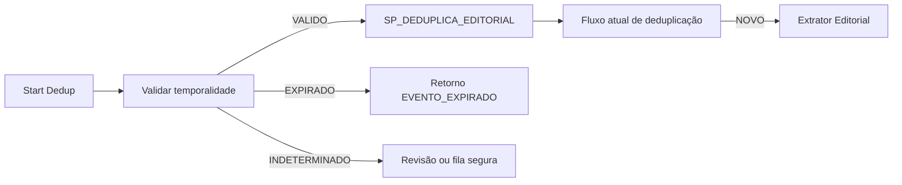

# Validade temporal antes da publicação

Data da proposta: 23/10/2026.

Iniciativa: `CORE-028`.

## Objetivo

Evoluir o Core produtivo atual para reconhecer referências temporais no título candidato, resolver a data de ocorrência do evento e impedir que conteúdo de serviço já vencido siga para publicação.

Essa proteção é independente do fluxo sombra de aprendizado. O modo sombra aprende relações entre evento, faceta e estado factual; a validação temporal atua como um gate operacional anterior ao Extrator Editorial.

## Risco observado no baseline

O candidato normalizado já preserva `data`, `iso_date` e `idade_horas`, mas o fluxo atual não transforma esses campos em validade editorial. Na similaridade v0.4.0, o termo `hoje` é removido como stopword e não participa de uma decisão temporal.

Quando o resultado lexical é `NOVO`, o workflow chama diretamente o `Chamar Extrator Editorial`. O Extrator cria rascunho, grava metadados, trata mídia e publica no WordPress. Portanto, deduplicação bem-sucedida não impede que uma pauta temporalmente vencida seja publicada.

## Exemplo de referência

Entrada observada:

- título: `Confira horários e onde assistir aos jogos de hoje com Flamengo e Europa League`;
- contexto: `Futebol agita quinta-feira com Libertadores, Europa League e clássicos femininos, prometendo emoções na tela.`;
- publicação ou referência original: quinta-feira;
- avaliação do Core: sexta-feira.

Resultado esperado: `EXPIRADO`, porque `hoje` deve ser resolvido em relação à data original do conteúdo, corroborada por `quinta-feira`, e não reinterpretado como a sexta-feira em que o Core executou. O Extrator Editorial não pode ser chamado.

## Princípios

1. Separar a data original do conteúdo, a data do evento e o instante de avaliação.
2. Usar explicitamente o fuso editorial `America/Sao_Paulo`; não depender do fuso implícito do servidor.
3. Resolver expressões relativas como `hoje`, `amanhã`, `ontem` e dias da semana a partir da data original confiável do conteúdo.
4. Preservar a expressão encontrada, a regra aplicada, a confiança e os instantes usados para auditoria.
5. Não confundir conteúdo pré-evento vencido com retrospectiva, resultado ou repercussão publicada depois do evento.
6. Incerteza não autoriza publicação automática: deve produzir `INDETERMINADO` e encaminhamento seguro.
7. O bloqueio funcional só pode ser promovido após replay, observação, feature flag e rollback testado.

## Fontes temporais e precedência

A resolução deve usar, nesta ordem:

1. data e horário explícitos do evento no título;
2. data explícita do evento no título ou contexto recebido;
3. expressão relativa ou dia da semana ancorado em `iso_date` da fonte;
4. campo `data` da fonte, quando sua semântica e timezone forem conhecidos;
5. instante de coleta, com confiança reduzida e sem reinterpretar retroativamente uma expressão relativa.

`idade_horas` pode servir como evidência auxiliar, mas não substitui um instante absoluto auditável. Quando a data original estiver ausente, inválida ou semanticamente desconhecida, a saída deverá ser `INDETERMINADO`.

## Intenção editorial

O vencimento automático é aplicável a conteúdo de serviço ou antecipação, incluindo sinais como:

- `onde assistir`;
- `horário` ou `horários`;
- `jogos de hoje`;
- `agenda`;
- `pré-jogo`;
- `provável escalação`;
- convites no futuro, como `confira` ou `veja`, quando associados a evento ainda não ocorrido.

Conteúdo de `RESULTADO`, `RETROSPECTIVA`, `REPERCUSSAO` ou atualização posterior não deve ser bloqueado apenas porque o evento ocorreu. A intenção precisa fazer parte da decisão e da evidência.

## Contrato proposto v0.1

```json
{
  "validade_temporal": {
    "versao": "0.1.0",
    "modo": "OBSERVACAO",
    "timezone": "America/Sao_Paulo",
    "instante_avaliacao": "2026-10-23T09:00:00-03:00",
    "referencia_conteudo": {
      "valor": "2026-10-22T08:00:00-03:00",
      "origem": "iso_date",
      "confianca": 1
    },
    "expressoes": [
      {
        "texto": "hoje",
        "data_resolvida": "2026-10-22",
        "regra": "RELATIVA_A_DATA_DO_CONTEUDO"
      },
      {
        "texto": "quinta-feira",
        "data_resolvida": "2026-10-22",
        "regra": "DIA_DA_SEMANA_CORROBORANTE"
      }
    ],
    "evento": {
      "inicio": "2026-10-22T00:00:00-03:00",
      "fim": "2026-10-22T23:59:59-03:00",
      "precisao": "DIA"
    },
    "intencao": "SERVICO_PRE_EVENTO",
    "status": "EXPIRADO",
    "confianca": 1,
    "motivos": [
      "EVENTO_ANTES_DA_AVALIACAO",
      "REFERENCIAS_TEMPORAIS_CONCORDANTES"
    ],
    "aplicado_automaticamente": false
  }
}
```

Estados mínimos:

| Estado | Significado | Comportamento pretendido |
| --- | --- | --- |
| `VALIDO` | Evento futuro ou ainda em curso | Prosseguir para deduplicação/publicação conforme as regras existentes |
| `EXPIRADO` | Conteúdo pré-evento com ocorrência encerrada | Encerrar sem chamar o Extrator e registrar evidência |
| `INDETERMINADO` | Âncora, intenção ou janela insuficiente/conflitante | Não publicar automaticamente; encaminhar para revisão ou fila segura |

## Posição no fluxo atual

A posição recomendada é antes de `SP_DEDUPLICA_EDITORIAL`:



Essa posição evita criar uma reserva para conteúdo que não deve ser publicado. Se uma implementação posterior mover o gate para depois da SP, será obrigatório definir uma finalização terminal idempotente para que o registro não permaneça em `PROCESSING`.

O contrato de retorno ao fluxo pai precisa aceitar `EVENTO_EXPIRADO` e `TEMPORAL_INDETERMINADO` sem convertê-los em `NOVO`, `ERROR` genérico ou sucesso de publicação.

## Casos de regressão iniciais

| Caso | Entrada | Avaliação | Resultado esperado |
| --- | --- | --- | --- |
| VT-01 | `jogos de hoje`, fonte de quinta-feira | sexta-feira | `EXPIRADO`; Extrator não chamado |
| VT-02 | `jogos de hoje`, fonte e avaliação na quinta-feira antes do término | quinta-feira | `VALIDO` |
| VT-03 | `resultado dos jogos de hoje` | depois dos jogos | intenção `RESULTADO`; não bloquear apenas pelo evento passado |
| VT-04 | `onde assistir no domingo` | sábado | `VALIDO`, com domingo resolvido no timezone editorial |
| VT-05 | `onde assistir hoje`, sem data original confiável | qualquer instante | `INDETERMINADO`; sem publicação automática |
| VT-06 | agenda com vários eventos, alguns vencidos e outros futuros | janela mista | `INDETERMINADO` até existir política editorial para publicação parcial |

## Implantação segura

1. Executar os casos de regressão e um replay histórico sem efeitos externos.
2. Ativar `OBSERVACAO`, registrando a decisão sem alterar o roteamento.
3. Medir cobertura, indeterminação, falso bloqueio e divergência editorial.
4. Habilitar por feature flag o bloqueio apenas para `EXPIRADO` de alta confiança.
5. Manter `INDETERMINADO` fora da publicação automática.
6. Validar que nenhum caminho bloqueado chama Extrator, WordPress, storage ou finalização `PUBLICADO`.
7. Testar desligamento imediato e retorno ao comportamento anterior.

## Critérios de aceite

- data original, data resolvida do evento, instante de avaliação e timezone são distintos e auditáveis;
- `hoje` é ancorado na data original do conteúdo, não no dia de processamento tardio;
- o caso VT-01 retorna `EXPIRADO` e não produz efeitos externos;
- retrospectiva e resultado não são bloqueados como se fossem conteúdo pré-evento;
- ausência ou conflito de âncora resulta em `INDETERMINADO`, nunca em publicação automática silenciosa;
- o fluxo pai reconhece os novos resultados;
- observabilidade, feature flag e rollback são validados antes do bloqueio funcional;
- alterações no workflow permanecem sanitizadas, inativas e acompanhadas do Code node correspondente no repositório.

## Dependências e decisões abertas

- confirmar a semântica, origem e timezone reais de `data` e `iso_date` no `Start Dedup`;
- obter snapshots sanitizados com títulos, datas de origem e instante de coleta;
- definir a política para eventos sem horário, eventos que atravessam a meia-noite e agendas mistas;
- definir o destino operacional de `TEMPORAL_INDETERMINADO`;
- confirmar que o fluxo pai aceita novos códigos de retorno;
- decidir onde persistir a auditoria sem criar escrita funcional indevida.

Nenhuma alteração produtiva foi executada nesta proposta.
