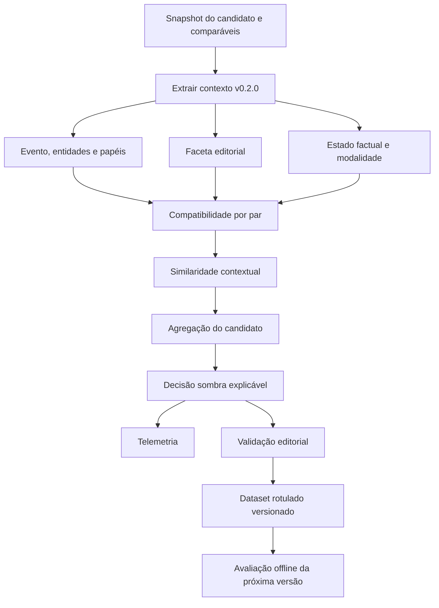

# Sprint: Deduplicação e Semântica Editorial v0.2.0

Status: **PLANEJADA — pronta para refinamento e execução**

Piloto: **M360**

Janela: **a definir conforme capacidade da equipe**

Atualização: **20/10/2026**

## Objetivo

Criar, em paralelo ao fluxo atual, um modo sombra que represente **evento, faceta e estado factual** antes da similaridade. O novo fluxo deverá produzir uma decisão editorial explicável para cada candidato, registrar telemetria e receber validação humana para evolução versionada das regras.

Durante esta Sprint, a decisão sombra não altera status, não publica conteúdo, não finaliza registros produtivos e não substitui o fluxo atual. A autonomia entregue é analítica: o fluxo executa a avaliação completa e sugere a decisão sem intervenção manual, mas sua aplicação funcional permanece bloqueada até os gates posteriores.

## Resultado da Sprint

Ao final da v0.2.0, o repositório deverá conter:

- export sanitizado e inativo do workflow M360 sombra;
- Code nodes separados e organizados por etapa;
- contrato versionado de evento, faceta e estado factual;
- DDL e SPs exclusivamente analíticas e idempotentes;
- avaliação de compatibilidade para cada candidato/comparável;
- score lexical atual e score contextual lado a lado;
- decisão sombra com motivos e evidências;
- mecanismo de coleta de rótulo editorial;
- replay dos 51 candidatos e 153 pares já catalogados;
- relatório de divergências entre baseline, sombra e validação humana;
- runbook de execução, observabilidade e desligamento.

## Princípios

1. O fluxo produtivo atual permanece a fonte funcional de verdade.
2. Evento, faceta e estado factual são extraídos antes do score contextual.
3. A análise ocorre por par; a decisão do candidato considera todos os pares relevantes.
4. Ausência de informação gera `DESCONHECIDO`, sem inferência forçada.
5. Toda decisão registra versão, evidências, bloqueadores e confiança.
6. O aprendizado depende de rótulos humanos e avaliação offline.
7. Nenhuma regra ou threshold se modifica automaticamente durante a execução.
8. Falha ou baixa confiança resulta em `INDETERMINADO` para revisão.

## Escopo

Incluído:

- títulos e metadados já disponibilizados ao fluxo M360;
- contratos e taxonomias editoriais;
- persistência analítica separada;
- execução offline e workflow sombra inativo;
- telemetria, explicabilidade e feedback humano;
- preparação para operação sombra com tráfego real.

Fora do escopo desta Sprint:

- alteração do workflow M360 produtivo;
- ativação do workflow sombra na instância produtiva;
- aplicação automática de `DUPLICADO`, `NOVO`, `RELACIONADO` ou `ATUALIZAÇÃO`;
- publicação, descarte ou mudança de status pelo novo modelo;
- alteração automática de pesos a partir do tráfego;
- extensão para PEL antes da validação do piloto M360;
- uso obrigatório do corpo completo das matérias.

## Fluxo alvo



## Contrato semântico v0.2.0

Cada candidato e comparável deve produzir, no mínimo:

```json
{
  "evento": {
    "tipo": "PARTIDA",
    "principal": true,
    "participantes": [],
    "entidades_secundarias": [],
    "competicao": null,
    "divisao": null,
    "rodada": null,
    "data_evento": null
  },
  "faceta": "DESCONHECIDA",
  "estado_factual": "DESCONHECIDO",
  "modalidade": "DESCONHECIDA",
  "confianca": 0,
  "campos_desconhecidos": [],
  "versao_extrator": "0.2.0"
}
```

Entidades devem possuir papéis. Um clube citado como observador ou contexto secundário não pode ser tratado automaticamente como participante do evento principal. Data do evento, publicação e coleta são campos distintos.

## Taxonomia de decisão

| Classe | Relação esperada |
| --- | --- |
| `DUPLICADO` | Mesmo evento, mesma faceta e mesmo estado informacional, sem contradição crítica no par determinante |
| `ATUALIZAÇÃO` | Mesmo evento e faceta, com avanço verificável do estado factual ou nova informação relevante |
| `RELACIONADO` | Mesmo evento ou contexto, com faceta editorial diferente |
| `NOVO` | Nenhum par compatível encontrado e cobertura de recuperação considerada suficiente |
| `INDETERMINADO` | Informação ausente, baixa confiança, conflito entre sinais ou cobertura insuficiente |

A incompatibilidade de um par não autoriza `NOVO`; os demais comparáveis precisam ser avaliados. Um match duplicado válido também não exige consenso de fontes distintas quando a identidade factual estiver confirmada.

## Histórias e tarefas

### S20-01 — Congelar o baseline

Mapeia: `CORE-003`, `CORE-004`.

Tarefas:

- obter as definições vigentes das duas SPs editoriais;
- confirmar o contrato do `Chamar Extrator Editorial`;
- registrar versões e hashes dos artefatos atuais;
- preservar uma matriz de entradas e saídas do fluxo M360.

Aceite:

- SPs sanitizadas e versionadas ou dependência formalmente mantida;
- contrato do subfluxo documentado;
- baseline reproduzível sem alterar a produção.

### S20-02 — Aprovar contratos e taxonomias

Mapeia: `CORE-005`, `CORE-006`.

Tarefas:

- definir schemas de contexto, comparação e decisão;
- aprovar listas de faceta, estado factual, modalidade e papéis;
- definir campos obrigatórios, desconhecidos e níveis de confiança;
- associar exemplos reais aos valores da taxonomia.

Aceite:

- contratos versionados com exemplos válidos e inválidos;
- critérios editoriais aprovados para as cinco classes;
- alterações futuras exigem nova versão.

### S20-03 — Criar persistência analítica

Mapeia: `CORE-007`, `CORE-008`.

Tarefas:

- modelar execução, snapshot, contexto, avaliação por par, decisão e rótulo;
- criar DDL separado das tabelas funcionais;
- criar SPs idempotentes de gravação e consulta;
- registrar versão do fluxo, extrator, taxonomia e regras.

Aceite:

- repetição da mesma execução não duplica evidências;
- nenhuma FK ou trigger altera tabelas funcionais;
- falha analítica não muda o resultado produtivo;
- scripts possuem rollback de estrutura para homologação.

### S20-04 — Extrair evento, faceta e estado

Mapeia: `CORE-010`.

Tarefas:

- identificar evento principal e referências secundárias;
- extrair entidades com papéis e atributos críticos;
- classificar faceta, estado factual e modalidade;
- preservar competição, divisão, rodada, datas, placar e quantidades;
- retornar confiança e campos desconhecidos.

Aceite:

- casos C07, C11, C12, C17, C19, C21 e C22 produzem os campos necessários para explicar a distinção editorial;
- `São Paulo`, `São Bernardo`, `Série A` e `Série B` permanecem entidades/atributos distintos;
- números são ligados ao atributo correspondente, em vez de tratados apenas como tokens.

### S20-05 — Avaliar compatibilidade por par

Mapeia: `CORE-011`.

Tarefas:

- comparar evento, participantes, papéis, competição e tempo;
- registrar bloqueadores críticos;
- distinguir diferença de faceta de conflito de evento;
- distinguir avanço factual de simples paráfrase;
- emitir relação e justificativas estruturadas.

Aceite:

- adversário, pessoa, competição, divisão ou evento incompatível bloqueiam duplicidade no par;
- facetas diferentes podem resultar em `RELACIONADO`;
- progressão factual pode resultar em `ATUALIZAÇÃO`;
- toda saída contém códigos de motivo auditáveis.

### S20-06 — Calcular similaridade contextual e decisão sombra

Mapeia: `CORE-009`, `CORE-012`.

Tarefas:

- preservar Similaridade v0.4.0 como baseline;
- calcular score contextual somente após compatibilidade;
- avaliar todos os matches disponíveis;
- agregar a decisão do candidato;
- gerar saída sombra sem roteamento funcional.

Aceite:

- baseline e proposta aparecem lado a lado;
- casos ambíguos não são decididos apenas pelo maior percentual;
- a saída inclui classe, confiança, par determinante, evidências e bloqueadores;
- nenhum node chama finalização produtiva, publicação, inserção funcional ou alerta operacional.

### S20-07 — Implementar feedback editorial

Mapeia: `CORE-014`.

Tarefas:

- coletar rótulo humano e par determinante;
- coletar motivo padronizado e observação opcional;
- registrar responsável, data e versão avaliada;
- separar sugestão automática de verdade editorial.

Aceite:

- o rótulo humano nunca é preenchido com a sugestão por padrão;
- correções preservam histórico e autoria;
- dataset exportável não contém cabeçalhos de e-mail ou dados pessoais desnecessários.

### S20-08 — Reprocessar evidências e medir

Mapeia: `CORE-013`.

Tarefas:

- executar os 51 candidatos e 153 pares acumulados;
- aplicar regressões prioritárias C07, C10–C17, C19, C21, C22 e A04;
- comparar baseline, sombra e rótulos disponíveis;
- registrar falhas, desconhecidos e divergências por regra.

Aceite:

- 100% das entradas possuem rastreabilidade ou erro explícito;
- nenhuma execução escreve em tabelas funcionais;
- relatório reproduzível informa cobertura, divergência e limitações;
- ausência de ground truth não é convertida em acerto presumido.

### S20-09 — Preparar operação e handoff

Mapeia: preparação para `CORE-015`.

Tarefas:

- criar métricas, logs e correlação por execução;
- documentar ativação, desligamento e recuperação;
- definir feature flag e limites de consumo;
- revisar segurança e sanitização dos artefatos;
- entregar roteiro para homologação e revisão editorial.

Aceite:

- workflow entregue inativo e sem credenciais;
- runbook demonstra que o modo sombra pode ser desligado sem afetar o fluxo atual;
- alertas diferenciam falha analítica de falha produtiva;
- todos os artefatos da Sprint estão versionados.

## Aprendizado supervisionado

O ciclo de aprendizado da v0.2.0 é:

1. o fluxo sombra gera contexto, decisão e motivos;
2. o editor confirma ou corrige a relação;
3. a evidência rotulada é versionada;
4. uma versão candidata de regras/pesos é avaliada offline;
5. métricas e regressões são comparadas com a versão vigente;
6. a nova versão só é promovida após revisão e aprovação.

Não haverá aprendizado online que altere pesos, taxonomias ou thresholds durante a execução. Isso evita deriva silenciosa e mantém cada decisão reproduzível.

## Telemetria mínima

- identificador da execução e do par;
- versões de workflow, extrator, taxonomia e regras;
- campos extraídos e respectivos níveis de confiança;
- bloqueadores e códigos de motivo;
- score lexical, score contextual e diferenças;
- decisão atual, decisão sombra e decisão humana;
- par determinante e cobertura dos comparáveis;
- duração, falha e etapa da falha;
- indicador explícito `aplicado_automaticamente: false`.

## Gates

| Gate | Condição | Liberação |
| --- | --- | --- |
| G0 — desenho | Contratos, taxonomias e baseline revisados | Implementação analítica |
| G1 — isolamento | DDL/SPs analíticas e workflow sem efeitos funcionais | Replay histórico |
| G2 — regressão | 51 candidatos e 153 pares rastreados; casos prioritários explicáveis | Homologação do modo sombra |
| G3 — feedback | Rótulos humanos e métricas por classe disponíveis | Tráfego real em sombra, mediante implantação autorizada |
| G4 — qualidade | Meta editorial de erro definida e atingida em amostra representativa | Decisão assistida ou veto conservador |
| G5 — autonomia | Canário, feature flag, observabilidade e rollback aprovados | Automação restrita por classe |

A conclusão desta Sprint atinge no máximo G2. G3 a G5 exigem ações posteriores, dados rotulados e autorização de implantação.

## Métricas

- cobertura dos campos de contexto;
- taxa de `DESCONHECIDO` por campo;
- precisão por classe após rotulagem;
- falso duplicado e falso novo;
- divergência baseline × sombra × humano;
- percentual de `RELACIONADO`, `ATUALIZAÇÃO` e `INDETERMINADO`;
- redução potencial de revisão manual;
- latência e taxa de falha analítica;
- estabilidade entre versões nos casos de regressão.

## Dependências

| Dependência | Item | Impacto |
| --- | --- | --- |
| Definições das SPs editoriais | `CORE-003` | Necessárias para congelar o contrato real do banco |
| Contrato do Extrator Editorial | `CORE-004` | Necessário para mapear o ramo `NOVO` e evitar conflito de responsabilidade |
| Revisão editorial | `CORE-006`, `CORE-014` | Necessária para taxonomia e ground truth |
| Ambiente de homologação n8n/MySQL | futura execução | Necessário para validar isolamento e idempotência |
| Amostras `NOVO` e `DUPLICADO` | avaliação | Necessárias para medir o sistema além do ramo `SUSPEITO` |

## Riscos e respostas

| Risco | Resposta planejada |
| --- | --- |
| Score alto por contexto genérico | Compatibilidade e papéis antes do score |
| Extração incompleta | `DESCONHECIDO`, confiança e revisão |
| Aprendizado com sugestão do próprio modelo | Separação obrigatória entre sugestão e rótulo humano |
| Deriva de regras | Versionamento e avaliação offline |
| Sobrecarga no fluxo atual | Execução assíncrona por snapshot/fila e limites de consumo |
| Escrita acidental em produção | Credencial analítica restrita, tabelas separadas e workflow inativo |
| Confusão entre mesma pauta e atualização | Estado factual, tempo e taxonomia `ATUALIZAÇÃO` |

## Definition of Done

A Sprint v0.2.0 estará concluída quando:

- histórias S20-01 a S20-09 tiverem evidência versionada ou dependência formal aceita;
- workflow sombra estiver sanitizado, inativo e sem caminho de efeito produtivo;
- Code nodes, SQL, contratos e runbook estiverem organizados conforme o padrão do repositório;
- replay histórico e relatório de divergências estiverem reproduzíveis;
- decisões possuírem explicação estruturada e versão;
- feedback humano estiver separado da sugestão automática;
- nenhum threshold tiver sido promovido apenas com a amostra de suspeitos;
- backlog e histórico estiverem atualizados;
- commit estiver publicado e o HEAD remoto confirmado.

## Ordem de execução

1. S20-01 e S20-02 — baseline e contratos.
2. S20-03 — persistência analítica.
3. S20-04 e S20-05 — contexto e compatibilidade.
4. S20-06 — decisão sombra.
5. S20-07 — feedback editorial.
6. S20-08 — replay e avaliação.
7. S20-09 — operação e handoff.

O backlog mestre permanece em [`docs/planejamento/BACKLOG.md`](../planejamento/BACKLOG.md).
